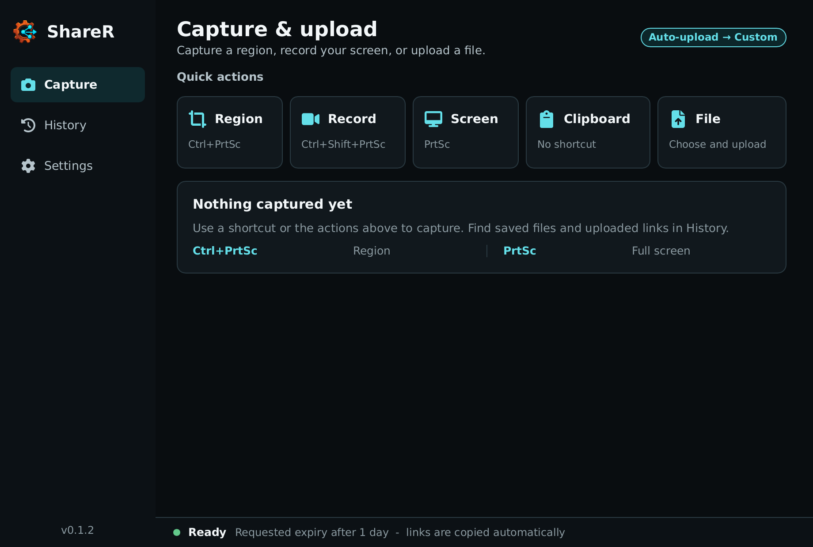
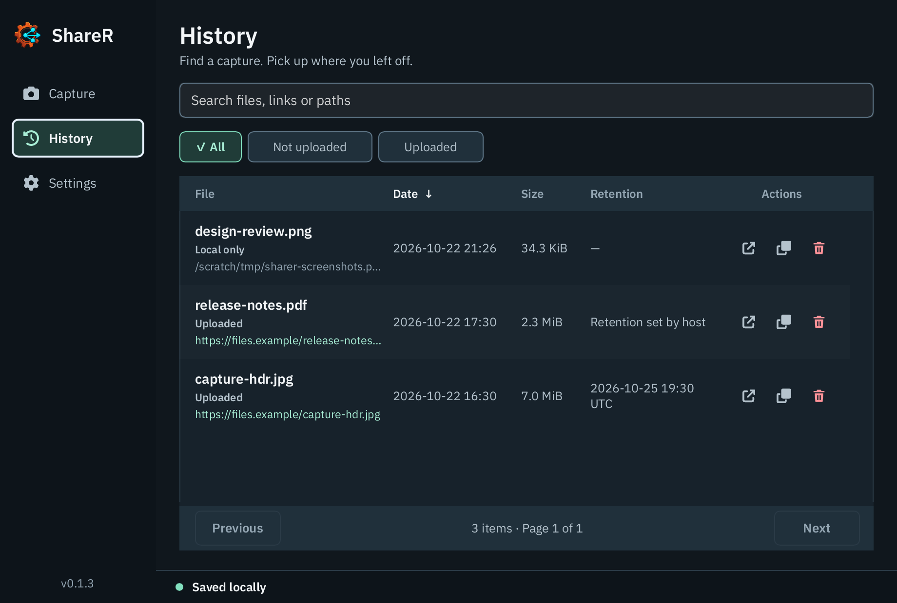
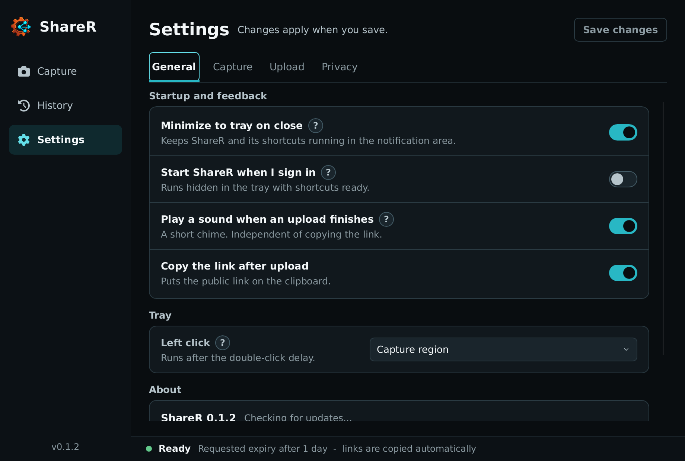
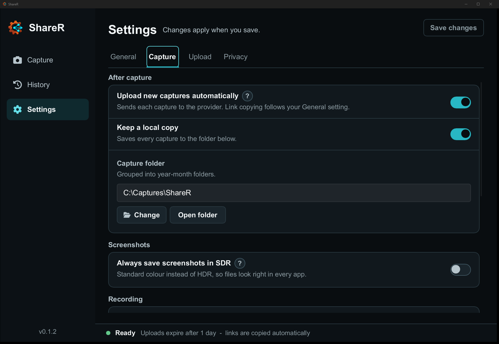
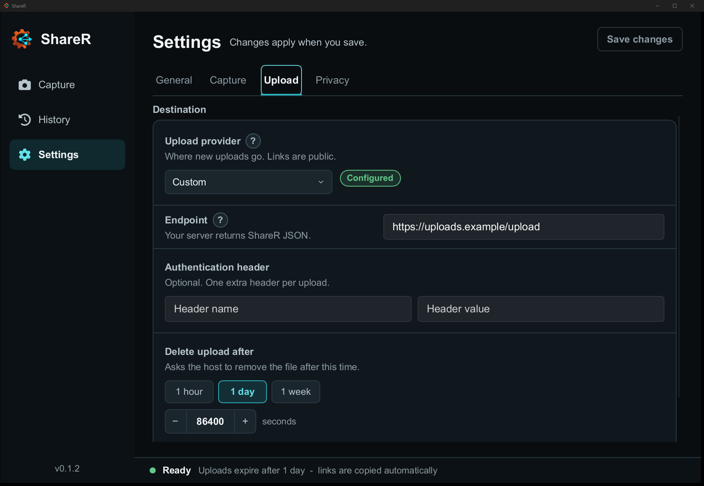
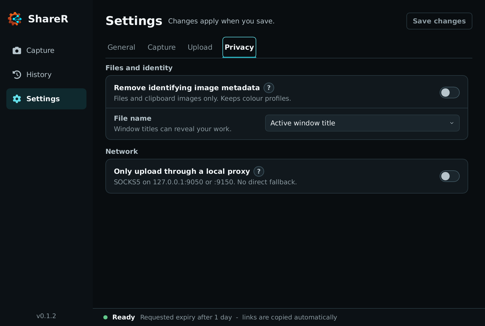
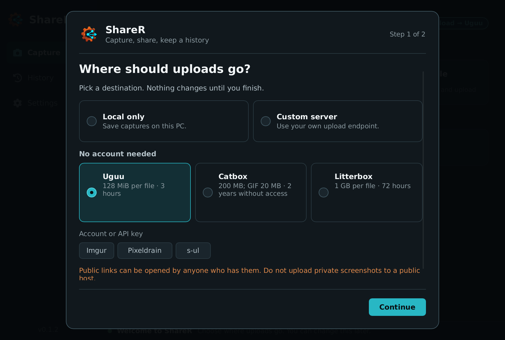

# ShareR

ShareR captures, records, and optionally uploads from one small desktop app. It handles screen regions, full displays, clipboard content, and ordinary files. Use one of the built-in providers or bring your own upload endpoint when you want public links.

## What you can do

**Capture what matters.** Drag an exact region, snap to a window, grab a full display, or record a region directly to animated WebP.

**Share almost anything.** Upload files, clipboard images, clipboard text, and copied files through the same workflow.

**Keep control.** First-run setup lets you choose any built-in provider, a custom endpoint, or local-only captures. Automatic uploads are on by default; setup must finish before desktop capture actions can run. You can remove identifying image metadata, hide window titles behind random names, and require a proxy when a direct upload is not acceptable.

**Stay out of the way.** ShareR lives in the system tray, responds to global shortcuts, and keeps old uploads in a small local history. Only one desktop instance runs per profile; launching ShareR again brings the existing window forward. Repeated `--background` launches leave it hidden. Headless commands such as `--history` are not blocked.

## Built to stay small

Low memory use is a core architecture constraint in ShareR. Files stream from disk, upload progress stays bounded, history loads in pages, and closing the window to the tray releases the desktop UI. Region selection prepares displays serially, keeps only bounded previews, and releases them after the click. The selected region is then recaptured at full configured quality, with temporary working buffers released as each processing stage completes. Generated captures and recordings move into the upload pipeline without copying their full buffers.

Recordings encode one independent frame at a time into a temporary file and stream that file for saving or upload. Each RGBA frame is limited to 32 MiB (enough for 3840 × 2160); select a smaller region or logical resolution if the physical pixels exceed this limit. The encoded output limit is configurable from 1 to 3 GiB (2 GiB by default) under **Settings → Capture → Recording**. The maximum stays below WebP's 32-bit container-size limit; a recording stops at the configured limit, saves or uploads its completed frames, and reports the stop reason. Duration and frame rate are separate settings. These limits bound capture and codec input, retained recording data, and output size; native codec scratch memory still depends on the frame dimensions. Independent frames can produce larger files than delta-compressed animations, especially for mostly static screens.

> “A move from 64K to 640K felt like something that would last a great deal of time. Well, it didn't.”
>
> [Bill Gates, 1989](https://csclub.uwaterloo.ca/resources/tech-talks/1989-bill-gates-talk-on-microsoft/)

## Screenshots

|                       Capture                       |                     History                     |
| :-------------------------------------------------: | :---------------------------------------------: |
|  |  |

|                      General settings                      |                      Capture settings                      |
| :--------------------------------------------------------: | :--------------------------------------------------------: |
|  |  |

|                     Upload settings                      |                      Privacy settings                      |
| :------------------------------------------------------: | :--------------------------------------------------------: |
|  |  |



## Install

Download the archive for your platform from the [latest release](https://github.com/legacy3/sharer/releases/latest):

- `sharer-windows-x86_64.zip`
- `sharer-linux-x86_64.tar.gz`
- `sharer-linux-headless-x86_64.tar.gz`
- `sharer-macos-aarch64.tar.gz`
- `sharer-macos-x86_64.tar.gz`

Release archives include signed build provenance. Verify a downloaded archive with the [GitHub CLI](https://cli.github.com/):

```console
gh attestation verify sharer-windows-x86_64.zip --repo legacy3/sharer
```

### Windows

Extract `ShareR.exe` somewhere permanent and launch it. Add that directory to your user `PATH` if you also want the CLI.

Or install from the Scoop bucket in this repository:

```powershell
scoop bucket add sharer https://github.com/legacy3/sharer
scoop install sharer/sharer
```

### macOS

Extract the archive and move `ShareR.app` to `/Applications`. Until release builds are signed, remove the download quarantine attribute and launch the app with:

```bash
xattr -dr com.apple.quarantine /Applications/ShareR.app
open /Applications/ShareR.app
```

You can instead try to open ShareR once, then approve it under **System Settings → Privacy & Security**. macOS asks for Screen Recording permission the first time ShareR captures the screen.

ShareR currently requires macOS 14 or newer. The CLI lives inside the app bundle:

```console
/Applications/ShareR.app/Contents/MacOS/ShareR --history
```

### Linux

Extract the archive and install the binary somewhere on `PATH`:

```console
chmod +x ShareR
sudo install ShareR /usr/local/bin/ShareR
```

The desktop archive contains the executable, not Ubuntu's native shared libraries. A normal desktop installation already has many of them. Install any missing runtime packages with:

```bash
sudo apt install libasound2t64 libayatana-appindicator3-1 libgbm1 libgtk-3-0t64 libpipewire-0.3-0t64 libxdo3 libxkbcommon0
```

The headless archive has no graphical dependencies.

## Set it up

On first start, ShareR asks where uploads should go. Uguu is the default because it needs no account; links are public and Uguu deletes files on its own schedule. You can choose any other built-in provider, a custom endpoint, or **Keep on this PC**. Automatic uploads and the successful-upload sound start enabled. Existing saved preferences are preserved when upgrading.

Choose **Use local only** to finish setup without automatic uploads. Run setup again from **Settings → General → Run setup again**; cancelling a replay leaves your saved settings unchanged. Reset stages the default preferences until you finish setup, while keeping provider credentials, the capture folder, history, and local files. Save or discard pending settings edits before opening setup again.

Imgur needs a client ID, s-ul needs an API key, and vgy.me accepts an optional user key. Uguu and transfer.sh work without credentials. The Custom provider accepts your own endpoint and one optional request header. The exact request and response format is documented in [Custom uploaders](docs/custom-uploaders.md).

Generated captures are saved locally by default under your Pictures directory in `ShareR/YYYY-MM`. Change the root folder or output behavior under **Settings → Capture**.

## Settings worth knowing

**Privacy.** Image metadata removal applies to files and clipboard images, not to generated screenshots. It detects JPEG, PNG, and WebP from their bytes, including renamed files, without recompressing the image. It removes EXIF, ordinary JPEG XMP/IPTC/comments, PNG text, and WebP XMP. Color profiles and recognized HDR gain-map metadata are preserved. Mixed or unsupported HDR XMP is rejected when it cannot be safely cleaned. File and reader uploads use a private temporary file when cleaning is needed, keeping memory bounded and leaving the source unchanged. This covers these metadata containers, not information visible in the pixels or arbitrary embedded payloads. Private names stop window titles from becoming capture filenames.

**Proxy routing.** Require proxy blocks uploads when no local SOCKS5 proxy responds on `127.0.0.1:9050` or `127.0.0.1:9150`, without a direct fallback. ShareR checks the SOCKS5 greeting, not whether the proxy uses Tor or provides anonymity. Use a proxy you trust; ShareR does not start or manage it. A detected proxy is also preferred when the requirement is off.

**Retina output.** Full-display screenshots on macOS can keep native pixels or use logical size, with Fast, Balanced, and Sharp resize filters. Interactive region screenshots use the macOS system picker and currently keep native pixels regardless of these preferences. Region recordings support logical size through ScreenCaptureKit's scaling; their selector currently presents the primary display.

**HDR output.** Windows HDR displays are detected automatically. **Always save screenshots in SDR** forces a standard SDR PNG when compatibility matters more than HDR. Turn it off to preserve HDR color on compatible displays. Automatic mode keeps HDR output available at every supported capture size. Screenshot processing may temporarily use memory proportional to the source display, selected region, resize filter, and encoded output, then releases those working buffers when capture processing completes.

**Upload feedback.** **Play a sound when an upload finishes** is on by default and plays only after a successful upload, independently of the clipboard. Local saves and failed uploads are silent. **Copy the link after upload** puts the public URL on the clipboard; the result card reports whether copying actually succeeded. Both options can be switched off under **Settings → General**.

**Start at login.** Adds a per-user startup entry for this copy of ShareR with `--background`. It starts hidden in the notification area, with shortcuts ready; no window opens at sign-in. If you move the app, enable the setting again from its new location. On Windows, ShareR only manages `HKCU\Software\Microsoft\Windows\CurrentVersion\Run` and respects the disabled state in Windows Startup settings. Linux uses `$XDG_CONFIG_HOME/autostart` when set, otherwise `~/.config/autostart`; macOS uses a per-user LaunchAgent.

On macOS, the startup switch checks the LaunchAgent file. A separate `launchd` disable override can still prevent login startup and is not reflected by the switch.

**Link lifetime and retention.** The Custom provider accepts a lifetime from one second to one week, with hour/day/week presets. Existing durations keep their exact seconds when you edit other settings or replay setup. Built-in providers decide retention themselves; ShareR cannot extend it. History shows the expiry returned by the host, or indicates host-managed retention when no expiry is supplied.

**History actions.** History records when each new capture was created and defaults to newest first; switch to oldest first from the page header. Right-click an entry, or use its action buttons, to open or copy its local file and path, reveal it in the system file manager, use its remote URLs, or remove it from history. The delete menu can open the host's deletion page, copy the deletion link, delete the local copy, or remove the history record only. Opening a deletion page asks for confirmation because the upload may be removed immediately.

**Upload a saved capture.** For a local-only history entry, choose **Open or upload… → Upload to _provider_**. This uses your saved upload and privacy settings without changing the original file. Save or discard pending settings edits first. A successful upload updates the existing entry; failure or cancellation keeps the file available for another attempt. If the entry was changed or removed during the upload, ShareR saves a new receipt instead so the returned links are not lost.

**Last result.** Local files and public links have separate, fully labelled actions. Opening a deletion page may remove the uploaded copy, not the local file. If you remove a history entry, the current result keeps its deletion link for recovery and warns that it is no longer saved. Failed jobs never leave an older upload's links active. If a local file survives a failed or cancelled upload, its actions remain available along with the upload error. A local-save failure stays visible even when uploading succeeds.

**Tray click.** A single left click captures a region by default. Change or disable that action under **Settings → General**. Double click opens ShareR, and right click opens the tray menu.

## Default shortcuts

| Action              | Shortcut                    |
| ------------------- | --------------------------- |
| Region capture      | `Control+PrintScreen`       |
| Region recording    | `Control+Shift+PrintScreen` |
| Full-screen capture | `PrintScreen`               |
| Clipboard upload    | Disabled                    |

Every shortcut can be changed under **Settings → Capture**. Clipboard upload has no global shortcut by default. Upload explicitly from the app or tray menu, or assign a shortcut to enable it.

## CLI

The desktop and headless builds use the same command-line interface:

```console
# Configure an uploader
ShareR --init https://uploads.example/upload
ShareR --init imgur --credential YOUR_CLIENT_ID

# Upload a file for one hour
ShareR document.pdf --time 3600

# Upload clipboard contents
ShareR --clipboard --time 86400

# Require a local SOCKS5 proxy and refuse a direct upload
ShareR document.pdf --require-proxy

# Require a proxy for every upload and the update check in this desktop session
ShareR --require-proxy

# Browse history
ShareR --history
ShareR --history --history-limit 5 --json

# Start the desktop app with its CPU-only recovery renderer
ShareR --renderer software
```

Successful uploads print the complete public URL using standard URL encoding. History and status displays escape control and bidirectional formatting characters and shorten very long fields. Use `--history --json` for complete original values; copy and open actions use the original links and paths.

Windows CLI output remains available to pipes and redirected files, including `ShareR --history --json > history.json`.

The desktop defaults to the platform's preferred renderer. On Windows Remote Desktop, `auto` selects the software renderer because the GPU path can produce a blank window there. Use `--renderer gpu` to force it anyway, or `--renderer software` if the GPU renderer is unavailable or misbehaves. `auto` continues to honor Slint's renderer environment overrides.

Windows region previews and recordings use Windows Graphics Capture, like full-screen screenshots, rather than the GDI screen-capture path.

`--require-proxy` also applies with `--background`. In a desktop session, changing the saved proxy preference cannot relax the command-line requirement. If ShareR is already running, quit it before relaunching with this flag; the second launch fails rather than silently using the existing session's routing. The flag does not change the saved preference. The older `--require-tor` and `--tor` flags remain aliases with the same proxy-only guarantee.

Run `ShareR --help` for every option.

## Platform support

| Platform  | Capture                                               | Recording   |
| --------- | ----------------------------------------------------- | ----------- |
| Windows   | Regions, windows, and full displays                   | Regions     |
| macOS 14+ | Regions, windows, and full displays with Retina input | Regions     |
| Linux     | X11 and supported Wayland screenshot portals          | X11 regions |

Global shortcuts require X11 on Linux. Wayland support depends on the compositor's screenshot portal.

## Data and backups

Settings and upload history live in `sharer.sqlite3`:

| Platform | Directory                                        |
| -------- | ------------------------------------------------ |
| Windows  | `%APPDATA%\sharer\config`                        |
| macOS    | `~/Library/Application Support/re.sharer`        |
| Linux    | `$XDG_CONFIG_HOME/sharer`, or `~/.config/sharer` |

Close ShareR before copying the database. It contains settings, capture history, local file paths, and sensitive deletion URLs. Local captures are stored separately under the configured capture directory, which defaults to `Pictures/ShareR`.

Set `SHARER_CONFIG_DIR` to keep settings and history in a custom directory, for example on a USB stick or in a test profile. The directory is created when missing.

## Contributing

Want to fix something or disagree with how it works? Good. Start with [CONTRIBUTING.md](CONTRIBUTING.md).

ShareR is available under the [MIT License](LICENSE).
